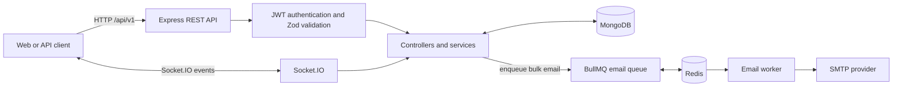
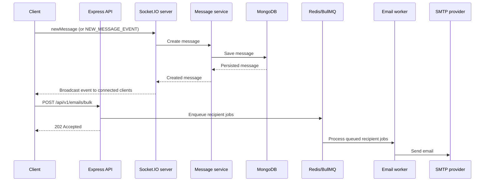

# Slack Backend

A REST API and real-time messaging backend for a Slack-inspired collaboration
platform. Built with Node.js, Express, MongoDB, and Socket.IO, this project
demonstrates authenticated workspace and channel management, persistent
messaging, and asynchronous bulk email delivery.

> **Hosted API:** Not deployed yet. The public backend URL will be added here
> after hosting. Once deployed, verify it at `https://<your-backend-host>/health`.

[Source code](https://github.com/Vineeth-28/Slack-Backend) ·
[API reference](#api-overview) · [Local setup](#getting-started)

## Contents

- [Project highlights](#project-highlights)
- [Architecture](#architecture)
- [Tech stack](#tech-stack)
- [Getting started](#getting-started)
- [Deployment](#deployment)
- [API overview](#api-overview)
- [Authentication](#authentication-flow)

## Project Highlights

- JWT-based user sign-up and sign-in; protected REST endpoints use the
  `X-Access-Token` header.
- Workspace creation and membership management, including joining a workspace
  with its join code and admin/member roles.
- Channel creation and management within workspaces.
- Persisted channel messages, paginated REST retrieval, and real-time
  Socket.IO message events.
- Asynchronous bulk email with BullMQ and Redis, retry/backoff, and a shared
  delivery rate limit.
- Zod request validation, centralized response/error handling, and Mongoose
  persistence.

### Feature status

| Feature                           | Status          | Notes                                                                                   |
| --------------------------------- | --------------- | --------------------------------------------------------------------------------------- |
| Workspace membership by join code | Implemented     | Adds a user to a workspace.                                                             |
| Socket.IO room/channel joining    | Not implemented | There is no room-join event; messages are currently broadcast to all connected clients. |

## Architecture



### Message and email flows



## Tech Stack

| Area                          | Technologies        |
| ----------------------------- | ------------------- |
| Runtime and API               | Node.js, Express.js |
| Data                          | MongoDB, Mongoose   |
| Real-time                     | Socket.IO           |
| Background jobs               | Redis, BullMQ       |
| Email                         | Nodemailer, SMTP    |
| Authentication and validation | JWT, Zod            |
| Code quality                  | ESLint, Prettier    |

## Project Structure

```text
Slack/
├── src/
│   ├── config/          # DB and server configuration
│   ├── controllers/     # Request handlers
│   ├── middlewares/     # Authentication middleware
│   ├── queues/          # BullMQ queue configuration
│   ├── repositories/    # Data access layer
│   ├── routes/          # API route definitions
│   ├── schema/          # Mongoose models
│   ├── service/         # Business logic
│   ├── templates/       # Email templates
│   ├── utils/           # Shared helpers and errors
│   ├── validators/      # Zod validation schemas
│   ├── workers/         # Background job processors
│   ├── server.js        # App bootstrap
│   └── ...
├── .env                 # Environment variables
├── .gitignore
├── eslint.config.js
├── package.json
├── README.md
└── package-lock.json
```

## Getting Started

### Prerequisites

- Node.js 20.19+, 22.13+, or 24+
- MongoDB (local instance or Atlas)
- Redis for the bulk-email queue and worker
- SMTP credentials to send bulk email
- npm

### Installation

1. Clone the repository:

```bash
git clone https://github.com/Vineeth-28/Slack-Backend.git
cd Slack-Backend
```

2. Install dependencies:

```bash
npm install
```

3. Create a .env file in the project root with the following values:

```env
PORT=3000
MONGO_URI=mongodb://localhost:27017/Slack
JWT_SECRET=your_super_secret_key
JWT_EXPIRY=1h
REDIS_HOST=127.0.0.1
REDIS_PORT=6379
REDIS_USERNAME=
REDIS_PASSWORD=
SMTP_HOST=smtp.example.com
SMTP_PORT=587
SMTP_USER=your_smtp_username
SMTP_PASS=your_smtp_password
SMTP_FROM=you@example.com
FRONTEND_URL=http://localhost:3000
```

Redis credentials are optional when the Redis service does not require
authentication. `SMTP_FROM` defaults to `SMTP_USER`. The API can start without
SMTP configured, but sending email requires valid SMTP host and sender settings.
`TEST_EMAIL` is only used by an optional email-test helper that the server does
not currently invoke.

### Run Locally

Start the application in development mode:

```bash
npm run dev
```

This will run the app with nodemon for automatic restarts during development.

For a normal start:

```bash
node src/server.js
```

Run one or more email workers in separate processes to process queued mail:

```bash
npm run worker:email
```

Each worker shares a queue-wide BullMQ limiter, so email delivery is capped at
100 messages per minute across worker processes. Failed sends are retried up to
five times with exponential backoff. Redis must be available to both the API and
worker processes.

## Deployment

This project does not have a public deployment yet. Add the hosted base URL to
the **Hosted API** line at the top of this README after deployment.

For a production deployment:

1. Provide the environment variables listed in the setup section using the
   hosting provider's secret/environment-variable settings.
2. Start the API with `node src/server.js`. The API and Socket.IO share the same
   HTTP server and port; configure the host to expose its assigned `PORT`.
3. If bulk email is enabled, run `npm run worker:email` as a separate
   background worker and configure the API and worker to use the same Redis
   service and SMTP credentials.
4. Configure a production MongoDB connection, a strong unique `JWT_SECRET`, and
   SMTP sender credentials. Do not commit `.env` or production secrets.
5. After deployment, check `https://<your-backend-host>/health` and replace the
   placeholder in the Hosted API section with the actual public URL.

### Health Check

The server exposes a basic health endpoint:

```bash
GET /health
```

Example response:

```json
{
  "message": "pong"
}
```

## API Overview

The backend is mounted under /api and versioned under /v1.

### Authentication

```http
POST /api/v1/users/signup
POST /api/v1/users/signIn
```

### Bulk email

```http
POST /api/v1/emails/bulk
X-Access-Token: <JWT>
Content-Type: application/json
```

The authenticated endpoint queues one job per recipient and accepts up to 100
unique email addresses per request (case-insensitive uniqueness). The subject
must be 1-200 characters, and at least one of `text` or `html` is required. Each
content field is limited to 20,000 characters, and the sender is always
`SMTP_FROM`.

```json
{
  "recipients": ["one@example.com", "two@example.com"],
  "subject": "An update from Slack",
  "text": "Here is the latest update."
}
```

When Redis accepts the jobs, the endpoint responds with HTTP 202. Sending is
asynchronous and limited to 100 emails per minute across workers.

```json
{
  "success": true,
  "message": "Emails queued successfully",
  "data": {
    "batchId": "generated-batch-id",
    "queued": 2
  }
}
```

### Workspaces

```http
POST /api/v1/workspaces
GET /api/v1/workspaces
GET /api/v1/workspaces/:workspaceId
POST /api/v1/workspaces/join
POST /api/v1/workspaces/:workspaceId/members
PATCH /api/v1/workspaces/:workspaceId/members/:memberId
DELETE /api/v1/workspaces/:workspaceId
```

### Channels

```http
POST /api/v1/workspaces/:workspaceId/channels
GET /api/v1/workspaces/:workspaceId/channels
GET /api/v1/workspaces/:workspaceId/channels/:channelId
PATCH /api/v1/workspaces/:workspaceId/channels/:channelId
DELETE /api/v1/workspaces/:workspaceId/channels/:channelId
```

### Messages

Retrieve messages from a channel. The authenticated user must be a member of the
workspace, and the channel must belong to that workspace.

```http
GET /api/v1/workspaces/:workspaceId/channels/:channelId/messages?page=1&limit=20
X-Access-Token: <JWT>
```

For example, with `curl`:

```bash
curl "http://localhost:3000/api/v1/workspaces/<workspaceId>/channels/<channelId>/messages?page=1&limit=20" \
  -H "X-Access-Token: <JWT>"
```

Both query parameters are optional. `page` defaults to `1`; `limit` defaults to
`20` and must be between `1` and `100`. Messages are returned newest first, with
the sender's username, email, and avatar included. A page beyond the available
messages returns an empty `data` array; the response does not include a total
count or additional pagination metadata.

Invalid pagination values return HTTP 400. Requests without a valid token are
rejected, and a user who is not a member of the workspace cannot read its
messages. A channel that does not belong to the requested workspace returns
HTTP 404.

Example response:

```json
{
  "success": true,
  "message": "Messages fetched successfully",
  "data": [
    {
      "_id": "message-id",
      "body": "Hello, everyone!",
      "channelId": "channel-id",
      "senderId": {
        "_id": "user-id",
        "username": "alex",
        "email": "alex@example.com",
        "avatar": "https://example.com/avatar.png"
      },
      "workspace": "workspace-id",
      "createdAt": "2026-11-06T12:00:00.000Z",
      "updatedAt": "2026-11-06T12:00:00.000Z"
    }
  ],
  "error": []
}
```

### Real-time messages

The Socket.IO server accepts `newMessage` (the recommended event name) and
`NEW_MESSAGE_EVENT` (an alias for clients using the constant's identifier as
the event name). A new message is broadcast to all connected clients on the
same event name it was sent on, after it has been saved.

Send a JSON object with all required message fields:

```json
{
  "body": "Hello, everyone!",
  "channelId": "<channelId>",
  "senderId": "<userId>",
  "workspace": "<workspaceId>"
}
```

`body`, `channelId`, `senderId`, and `workspace` are required. Plain text alone
cannot be saved as a message.

## Authentication Flow

- Users sign up with email, username, and password.
- Passwords are hashed before storage.
- Users sign in to receive a JWT token.
- Protected routes require the JWT token in the `X-Access-Token` header.

## Scripts

```bash
npm run dev        # start the server in development mode
npm run lint       # run ESLint checks
npm run lint:fix   # auto-fix lint issues
npm run format     # format code with Prettier
npm run format:check
npm test           # run the test suite
```

The test command currently finds no test files, so it exits successfully with
zero tests.

## License

This project is licensed under the ISC License.

## Author

Vineeth-28
